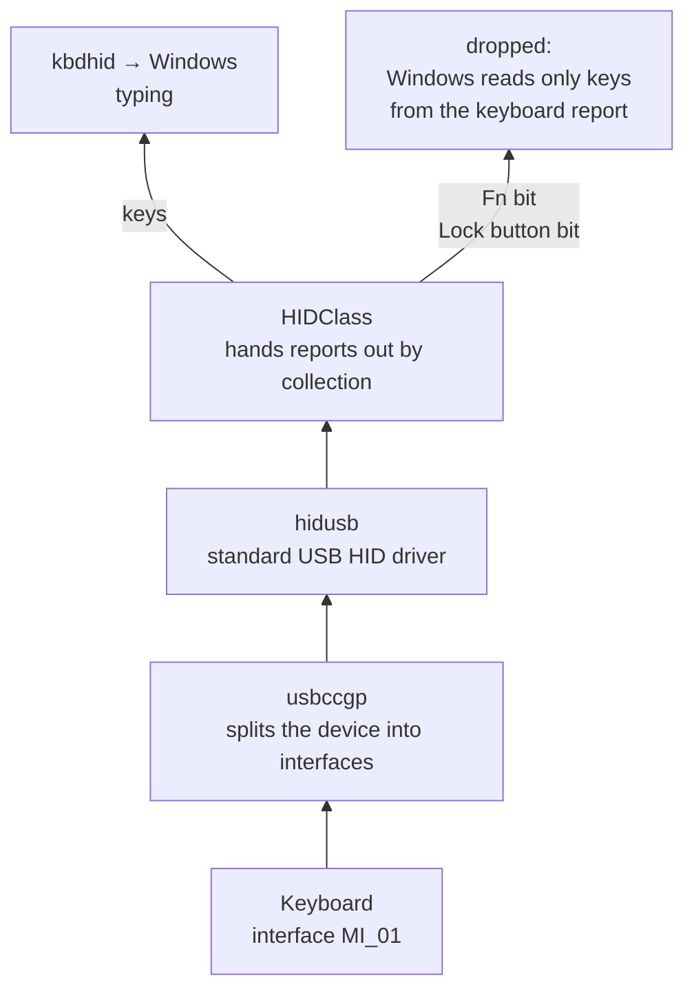
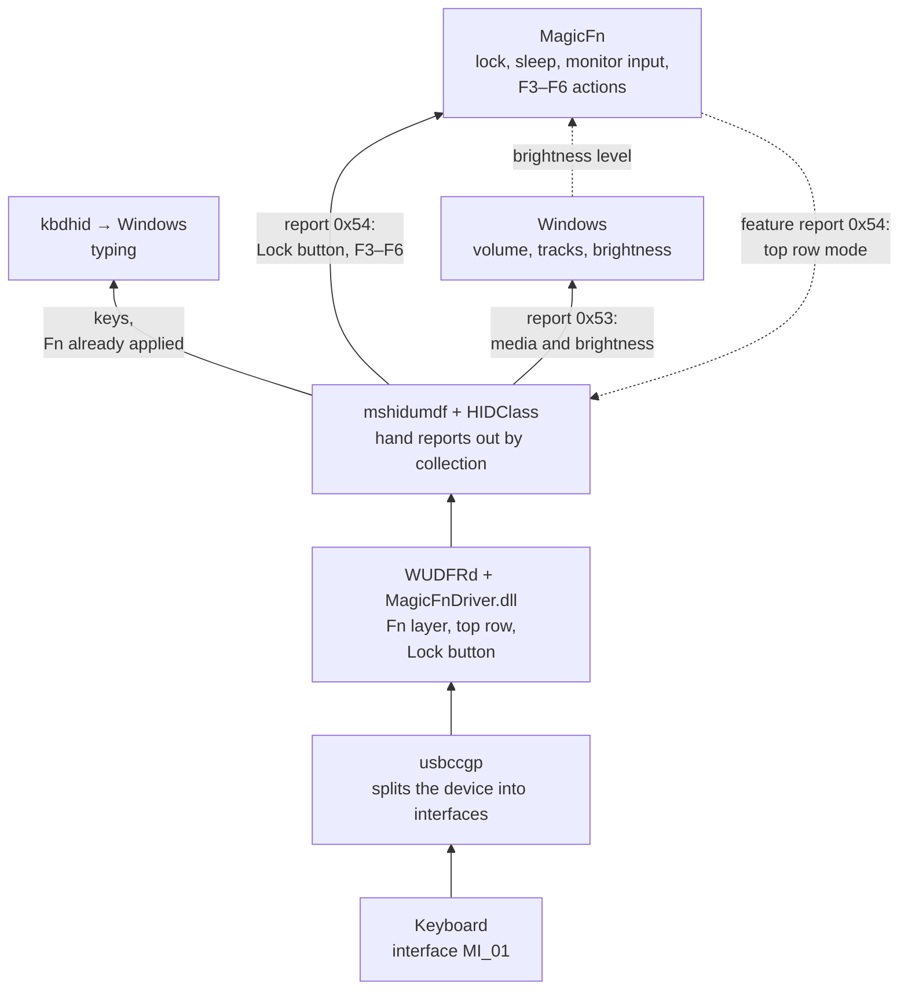

# MagicFn

The Fn key, the whole top row, brightness and the Lock button for the Apple Magic Keyboard on Windows — with its own user-mode driver and one tray program.

Tested on a Magic Keyboard with Touch ID, USB-C (`VID_05AC` `PID_0321`) over a cable, Windows 11 23H2, external monitor on DisplayPort.

> [!WARNING]
> **This driver sees every key you press on this keyboard, passwords included.** That is unavoidable for a keyboard driver: MagicFnDriver replaces the standard Windows one, so every keystroke passes through it, and it rewrites some of them to make the Fn layer work.
>
> What it does with them: reads a report from the keyboard, applies the Fn layer, hands it to Windows. It does not store keystrokes and does not send them anywhere — the driver has no file, registry or network code. The MagicFn tray program never sees ordinary keys at all, only the Lock button and F3–F6.
>
> Do not take that on trust. The whole driver is one file, [`driver/MagicFnDriver.c`](driver/MagicFnDriver.c), about 500 lines. If you do not trust the prebuilt DLL, read the source and [build it yourself](#building).

## What works

| Keys | Action |
| --- | --- |
| Lock button | lock, sleep or switch the monitor input (chosen in the settings) |
| Fn + F1 / F2 | brightness (the Windows slider, the monitor follows it) |
| Fn + F3 | Task View |
| Fn + F4 | search |
| Fn + F5 | voice typing |
| Fn + F6 | turn Do Not Disturb on or off |
| Fn + F7 / F8 / F9 | previous track / pause / next track |
| Fn + F10 / F11 / F12 | mute / volume down / volume up |
| Fn + Esc | lock, sleep or Task Manager (chosen in the settings) |
| Fn + Backspace | Delete |
| Fn + arrows | Home / End / Page Up / Page Down |
| Fn + Enter | Insert |
| Fn + Shift + F11 / F12 | Print Screen / Scroll Lock |
| Ctrl + Alt + Backspace | Ctrl + Alt + Delete |

The top row mode (standard F1–F12, or the actions without Fn) is switched in the settings and applies to all twelve keys.

Who does what:

- **the driver alone, without MagicFn** — the Fn layer, brightness, tracks and volume;
- **MagicFn** — the Lock button, F3–F6, Fn + Esc, external monitor brightness and the top row mode. While the program is not running, these keys do nothing, and the top row works as standard F1–F12 with media on Fn.

Not working: Touch ID, and all of the above over Bluetooth. The driver does not arm the keyboard to wake the computer.

## Where the driver sits

To Windows the keyboard is three USB interfaces. MagicFnDriver takes one of them, `MI_01`:

| Interface | What it is | Driver |
| --- | --- | --- |
| `MI_00` Device Management | Apple's service channel | standard, does not start (code 10) — same as before MagicFnDriver |
| `MI_01` Keyboard / Boot | keys, Fn, the Lock button | **MagicFnDriver** |
| `MI_02` Touch ID | fingerprint sensor | standard, not used |

The driver stack on `MI_01`, top to bottom. Data from the keyboard travels bottom to top:

| Layer | Whose | What it does |
| --- | --- | --- |
| `kbdhid`, `kbdclass` | Microsoft | turn keyboard reports into keystrokes |
| `HIDClass` + `mshidumdf` | Microsoft | hand reports out by collection; `mshidumdf` is the bridge between the kernel and the user-mode driver |
| `WUDFRd` + **`MagicFnDriver.dll`** | Microsoft + ours | the UMDF layer in the kernel and the driver itself in a `WUDFHost.exe` process |
| `usbccgp` | Microsoft | splits the USB device into interfaces |

MagicFnDriver sits in the place of the standard `hidusb`. Everything below and above it is a Windows component.

With the standard Windows driver the Fn bit and the Lock button bit reach the top and are lost there:



With MagicFnDriver the report is taken apart before it reaches Windows, and each part goes to its own receiver:



Solid arrows are data from the keyboard, dashed arrows are feedback: MagicFn tells the driver the top row mode and passes the Windows brightness level on to the external monitor.

What the driver does with the data:

- reads keyboard reports over USB and hands them to Windows;
- on the way applies the Fn layer and turns F1–F2 and F7–F12 into media keys (the same pairs as Apple's Boot Camp driver);
- removes the Lock button and the media-layer F3–F6 from the key stream and reports them separately;
- appends two collections to the report descriptor the keyboard provides:

| Collection | Report | Purpose |
| --- | --- | --- |
| Consumer Control | `0x53` | media keys and brightness, handled by Windows itself |
| page `FF00`, usage `0x10` | `0x54` | input report — one byte with a bit per pressed key: the Lock button and the media-layer F3–F6; feature report — the top row mode |

The second collection opens without administrator rights: MagicFn reads the Lock button and F3–F6 from it and writes the top row mode to it. The driver forgets the mode on reconnect and after sleep, so the program repeats it on every device change.

Why it is done this way:

- The keyboard sends the Lock button as bit `0x04` in the last byte of the keyboard report. Windows takes only keys from that report, and programs cannot subscribe to a "keyboard" collection — so the bit is moved to a separate collection.
- F3–F6 are not turned into keystrokes, although that would be simpler. The first version sent Win + Tab and F16 for them, and Windows stopped registering the key release whenever the press fired a hotkey: the key stayed down, repeated presses did nothing, and ordinary letters turned into shortcuts. The separate collection has no such problem.
- The driver reads the keyboard with one request at a time: with two in parallel a release report can overtake its press report.
- A user-mode driver (UMDF 2) signed with its own certificate installs without test mode and with Secure Boot on. A bug in it crashes the driver process, not the system.
- A filter between `kbdhid` and `HIDClass` does not work: UMDF cannot return data into a read that `kbdhid` issues from the kernel.
- `WinUsb` is not needed in the stack and gets in the way: the UMDF layer talks to USB itself (`UmdfDispatcher=NativeUSB`).
- Apple's `KeyMagic2` driver must not be left under MagicFnDriver: it reads the request buffer through a direct pointer, the UMDF layer passes it differently, and `KeyMagic2` crashes with a blue screen.

## Installation

The repository includes ready builds: `MagicFn.exe`, `MagicFnSetup.exe` and the signed driver in `driver\package`. To build them yourself, see [Building](#building).

Administrator rights and .NET Framework 4.8 (part of Windows 10/11) are required.

1. Connect the keyboard with a cable and run `MagicFnSetup.exe`. It asks which driver to install:
   - **1 — MagicFnDriver**: our own driver, the Lock button works. The `driver\package` folder must be next to the installer.
   - **2 — Apple KeyMagic2** from Boot Camp: a fallback without the Lock button. The `bootcamp-magic2-original` folder must be next to the installer (see [Fallback: Apple's driver](#fallback-apples-driver)).
2. The installer starts `MagicFn.exe` itself (or restarts it if it was running). Open the settings with a double click on the "fn" tray icon and turn on "Start at Windows sign-in". Autostart remembers the current file path, so first put the program where it is going to live.

The `LG` flag turns on the monitor input switch in MagicFn: `MagicFnSetup.exe magicfndriver LG`. Without it MagicFn controls monitor brightness only, and every install without the flag turns the switch off again. The switch is tested on an LG monitor only, so it is hidden by default.

The choice can be passed as an argument: `MagicFnSetup.exe magicfndriver` or `MagicFnSetup.exe apple`. Installing one driver replaces the other. `MagicFnSetup.exe check` shows the keyboard it found and the entry in Apple's INF without changing anything.

Installing MagicFnDriver adds the `MagicFn driver signing` certificate to the trusted roots and trusted publishers of this machine — without that Windows does not accept a self-signed driver. Whoever holds the private key of that certificate can sign drivers this machine will trust.

### Giving the driver to someone else

A folder with `MagicFn.exe`, `MagicFnSetup.exe` and `driver\package` (four files: `.inf`, `.cat`, `.dll`, `.cer`) is enough. The recipient needs neither Visual Studio nor the WDK. The private key of the certificate stays in the store of whoever built the package and is not part of the folder. The driver is made for `PID_0321` and a cable.

## Settings

- **Start at Windows sign-in.**
- **Control external monitor brightness** — pass the brightness to the monitor over DDC/CI. On a laptop with a built-in screen, untick it.
- **Top row without Fn** — standard F1–F12, or brightness, media and volume.
- **Fn + Esc** — nothing, lock, sleep or Task Manager.
- **Lock button** — nothing, lock or sleep.
- The F3–F6 actions are not configurable.
- **Lock button switches monitor input** — present only after an install with the `LG` flag; the button switches the monitor to the input chosen in the list next to it (DisplayPort 1/2, HDMI 1/2) and then does its own action; choose "Nothing" for the Lock button to only switch. One way only: while the monitor shows another input it ignores commands from this computer (checked on an LG 27GR75Q). Switch back with the monitor's own button or with the same command from the second device.

"Apply" saves the settings without closing the window. They are stored in `HKCU\Software\MagicFn`.

## How MagicFn works

- Windows handles the brightness codes itself but does not reach an external monitor. MagicFn subscribes to brightness changes in the power scheme and passes the level to the monitor over DDC/CI.
- The driver turns Fn + Esc into Pause, which is registered as an ordinary hotkey.
- The program reads the Lock button and F3–F6 from the driver's collection on a separate thread and reacts to a press.
- It performs F3–F5 itself by pressing Win + Tab, Win + S and Win + H for you.
- Windows has neither a hotkey nor a documented API for Do Not Disturb. F6 toggles it through an internal shell interface, the same one behind the bell button. Checked on Windows 11 23H2; if a Windows update removes the interface, the key will stop doing anything.
- The monitor input is switched over DDC/CI. LG monitors ignore the standard VCP code `0x60`: they need code `0xF4` with source address `0x50` instead of `0x51`, and the stock Windows API cannot change that address. So the command is also sent as raw I2C through the NVIDIA driver (`nvapi64.dll`); on AMD and Intel the input of an LG monitor will not switch.

The program polls nothing on a timer and does not hook the keyboard. It presses keys itself only for F3–F5.

## Building

MagicFn and the installer (close a running MagicFn before building):

```bash
C:\Windows\Microsoft.NET\Framework64\v4.0.30319\csc.exe /nologo /codepage:65001 /target:winexe /out:MagicFn.exe MagicFn.cs
```

```bash
C:\Windows\Microsoft.NET\Framework64\v4.0.30319\csc.exe /nologo /codepage:65001 /platform:x64 /out:MagicFnSetup.exe MagicFnSetup.cs
```

The driver needs Visual Studio with the Windows Driver Kit component, plus the Windows SDK and WDK of the same version. The script builds `driver\package` and signs it with a certificate from the current user's store (created on the first build):

```bash
powershell -ExecutionPolicy Bypass -File driver\build.ps1
```

After a rebuild install the driver again: `MagicFnSetup.exe magicfndriver`.

## Uninstalling

1. MagicFn: untick autostart, exit the program, delete the file and the `HKCU\Software\MagicFn` key.
2. MagicFnDriver, in an administrator terminal:

```bash
powershell -ExecutionPolicy Bypass -File driver\uninstall.ps1
```

The script removes the driver, removes the certificate from the trusted stores and starts the Apple driver install so that Fn keeps working. If you do not want Apple's driver, close its window — the keyboard stays on the standard Windows driver.

3. Apple's driver: Device Manager → "Apple Keyboard" → Properties → Driver → **Roll Back Driver**.

## Fallback: Apple's driver

`MagicFnSetup.exe apple` force-installs `KeyMagic2` from the `bootcamp-magic2-original` folder (its INF does not list this keyboard's ID), adds the keyboard to the driver's table and restarts the device:

```bash
reg add "HKLM\SYSTEM\CurrentControlSet\Services\KeyMagic2\KeyboardTable" /v "VID_05AC&PID_0321" /t REG_BINARY /d 0200000101 /f
```

Do not change the value `0200000101`: with type `01` in the first byte the driver stops creating the media-key channel.

With Apple's driver Fn and the media keys work, but not the Lock button: the driver ignores its bit. The current MagicFn is made for MagicFnDriver and does not talk to Apple's driver: the top row mode stays whatever is in the driver's registry, brightness on F1–F2 does not work, and F3–F6 are plain function keys.

The driver belongs to Apple and is not part of this repository. Take it from `BootCampESD.pkg` (March 2022) on Apple's update server, folder `BootCamp\Drivers\Apple\AppleKeyboardMagic2`, and put its contents into `bootcamp-magic2-original` next to the installer:

```
https://swcdn.apple.com/content/downloads/48/55/002-34411-A_GQNVCB6UOC/m67xlo3dipbdxmdeeocd39hmxka5o9dg2k/BootCampESD.pkg
```

## Bluetooth

Over Bluetooth the keyboard works as a plain one, without Fn. MagicFnDriver is a driver for the cable. Apple's driver attaches to the Bluetooth keyboard but sees no keystrokes: it intercepts only reads of 10–11 bytes, and the Touch ID model has a 651-byte read buffer. Windows shows the Bluetooth battery level itself.

## Other keyboard models

MagicFnDriver is bound to `USB\VID_05AC&PID_0321&MI_01` in `driver\MagicFnDriver.inx` and expects a 10-byte report: Fn is bit `0x02`, the Lock button is bit `0x04` of the last byte. It has not been tested on other models. For Apple's driver the model number is the `Pid` constant in `MagicFnSetup.cs`.

## License

[GPL-3.0](LICENSE). Apple's Boot Camp driver is not covered and is not part of this repository.
